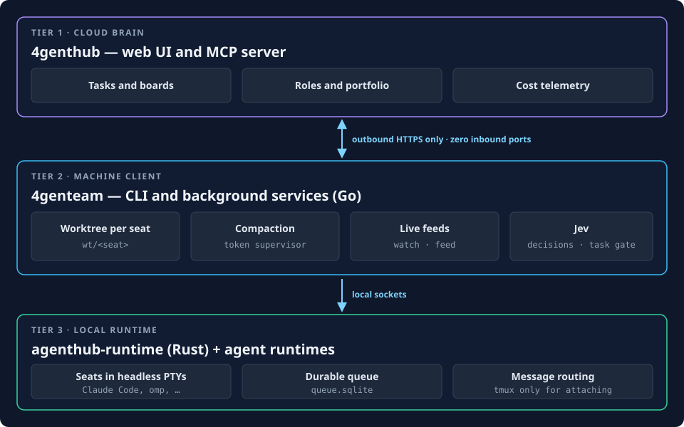

# Overview

> **Run an autonomous, self-improving team of AI coding agents on your own machine, on any project.**

Agents work concurrently in isolated Git worktrees, hand off tasks through a durable queue, offload bulk boilerplate to cheap models, and monitor token usage via automated compaction.

## Quickstart

### 1. Install tooling
```bash
# The client; it also ships the local runtime (`agenthub-runtime`)
# (Build from the agenthub_client repo into your PATH)
go build -o ~/.local/bin/4genteam agenthub_client/cmd/4genteam
```

### 2. Define your team (`team.json`)
In a directory of your choice (for example `~/teams/dev-team/`):
```json
{
  "room": { "slug": "dev-team" },
  "seats": [
    { "seat_key": "dev",      "seat_type": "developer", "runtime": "claude-code", "model": "sonnet" },
    { "seat_key": "reviewer", "seat_type": "reviewer",  "runtime": "claude-code", "model": "sonnet" }
  ]
}
```

### 3. Launch and watch
```bash
# Start the team & provision worktrees
4genteam up dev-team --team ~/teams/dev-team

# Send a mission
4genteam send --from owner dev-team dev 'Write a factorial utility with tests. Record a queue item when done.'

# Stream live tool execution with word-wrapped output & token meters
4genteam feed --rig dev-team --detail
```

The full walkthrough is in [Prerequisites](01-prerequisites.md) and [Five-Minute Quickstart](02-five-minute-team.md).

## Architecture: the 3-tier model



```
[ Tier 1: Cloud Brain ]
   4genthub (Web UI & MCP Server)
      - Tasks, boards, roles, portfolio, and cost telemetry
             ▲
             │ Outbound HTTPS only (Zero Inbound Ports)
             │
[ Tier 2: Machine Client ]
   4genteam (Unified CLI & Background Services)
      - Provisions isolated git worktrees per seat (wt/<seat>)
      - Runs token compaction supervisor and live terminal feeds
      - Runs Jev locally: seats ask it for decisions and close tasks through its gate
             │
             ▼ Local Sockets
[ Tier 3: Local Runtime ]
   agenthub-runtime (Rust) + agent runtimes (Claude Code, omp, ...)
      - Runs each seat in a headless PTY; tmux is only a bridge for attaching
      - Keeps the room's durable queue (queue.sqlite) and routes messages
```

## Safety and rules of thumb

1. **Worktrees over shared checkouts:** Never allow multiple agents to write in the same folder. Each seat operates in `wt/<seat>`.
2. **Queue over ephemeral chat:** If work or context must survive restarts, store it as a queue item or markdown doc.
3. **Expensive plans, cheap drafts:** Use top-tier models (Claude Sonnet, Opus) for planning and review; offload bulk boilerplate to cheap models (DeepSeek).
4. **Humans push, agents commit:** Agents commit locally with pathspecs. Only human operators approve pushes to remote branches.
