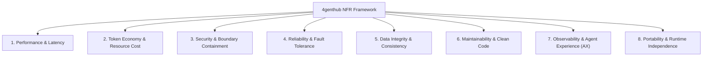
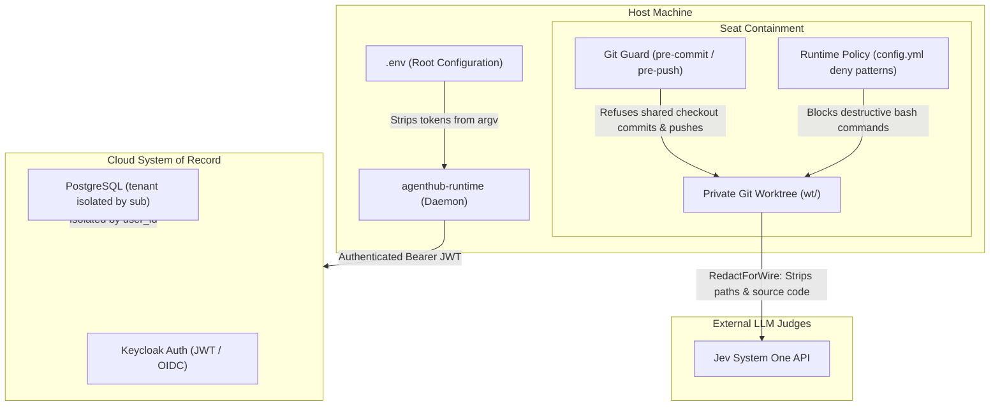

# 4genthub: Comprehensive Non-Functional Requirements (NFR) Analysis

> **SUPERSEDED 2026-10-19**: this is a claim catalogue, not the doc of record. The register is `ai_docs/core-architecture/nfr-register.md`; 15 of the 43 rows below name a mechanism, scope or number the code contradicts.

> **Scope**: Entire system architecture including the Cloud Backend (`agenthub_go`), React Web Frontend (`agenthub-frontend`), Local Client (`agenthub_client` / `4genteam`), Runtime Daemon (`agenthub-runtime`), and Multi-Agent Orchestration Subsystem (Seat Model, Guardrails, Jev Gate).
> **Single Source of Truth References**: `ai_docs/core-architecture/`, `ai_docs/agent-system/`, `ai_docs/operations/`, and `AGENTS.md`.

---

## 1. Executive Summary & Quality Attribute Framework

4genthub is an autonomous multi-agent software engineering orchestration platform. Unlike single-agent coding assistants, 4genthub coordinates heterogeneous AI models (Claude, DeepSeek, Gemini, Codex) configured as durable "seats" inside collaborative "rooms", interacting with a centralized Cloud System of Record and local Git worktrees.

The system's overarching North Star KPI is:
$$\text{KPI} = \frac{\text{Verified Software Delivered}}{\text{Human Attention Units}}$$

To achieve this KPI without degradation over time, the system enforces strict **Non-Functional Requirements (NFRs)** categorized under the ISO/IEC 25010 Quality Model, adapted specifically for agentic software execution:

---

## 2. Categorized Non-Functional Requirements

### Category 1: Performance Efficiency & Latency

| ID | Requirement | Target Metric / Threshold | Architectural Mechanism & Enforcement |
|---|---|---|---|
| **PERF-01** | REST API Latency | Average response $< 200\text{ ms}$ under nominal load | Go `net/http` DDD backend, connection pooling via `pgx`, avoidance of heavy ORM translation layers (`database.Tables` direct structs). |
| **PERF-02** | Context Sync Overhead | Context read/resolution $< 5\text{ ms}$ | In-memory inheritance computation across the four context tiers (Global $\rightarrow$ Project $\rightarrow$ Branch $\rightarrow$ Task). |
| **PERF-03** | Local IPC Latency | Daemon IPC round-trip $< 10\text{ ms}$ | Unix domain socket communication (`/mnt/wslg/runtime-dir/agenthub.sock`) using length-prefixed binary/JSON frames. |
| **PERF-04** | Real-Time Sync Latency | End-to-end WebSocket fanout $< 500\text{ ms}$ | `/ws/realtime` v2.0 event broadcaster pushes minimal state deltas directly to frontend React Query cache. |
| **PERF-05** | Delta Payload Optimization | State transition payloads $< 500\text{ bytes}$ | Completion and status changes broadcast minimal delta frames rather than full 2KB+ entity snapshots; frontend merges deltas into cache. |
| **PERF-06** | Real-Time Terminal Streaming | Unbuffered tool execution output | SSE and unbuffered PTY streaming to `herdr` panes; zero line-buffering delay on stdout/stderr feeds. |

---

### Category 2: Token Economy & Resource Cost Optimization

Because LLM API usage constitutes the primary operating expense and context bloat degrades model reasoning, token management is a critical non-functional requirement.

| ID | Requirement | Target Metric / Threshold | Architectural Mechanism & Enforcement |
|---|---|---|---|
| **COST-01** | Context Compaction Ladder | 3-tier progressive limit: Soft ($150\text{k}$), Warn ($200\text{k}$), Hard ($250\text{k}$) | Automated `compact-run` supervisor inspects live session logs every 10 seconds: (1) tells agent to stop at soft limit, (2) compacts at warn limit, (3) aborts running turn at hard limit. |
| **COST-02** | Force-Compaction Capability | Deterministic compaction execution | Dedicated std-only Rust binary (`agenthub_client/rust/forcecompact`) uses `pidfd_getfd` to duplicate the runner socket and trigger RPC `/compact` out-of-band even if the agent is actively executing. |
| **COST-03** | Off-Peak Cost Routing | DeepSeek half-price billing gating | `4genteam offpeak` gate enforces that rooms running `deepseek/` models are refused during peak billing hours (01:00–15:00 UTC Mon–Fri) unless `--allow-peak` is explicitly flagged. |
| **COST-04** | Workload Offloading | Offload bulk tasks to subagents | `deepseek-offload` harness routes repetitive, parallelizable, or high-token tasks (codebase grep, documentation scanning, bulk refactors) to `deepseek-flash` background harnesses. |
| **COST-05** | Terse Protocol Communication | Strict character caps on queue items | Queue row bodies strictly limited to 600 chars total (`facts` $\le 280$, `rule` $\le 110$, `decision` $\le 100$, `next` $\le 78$; summary $\le 120$). Eliminates verbose model-to-model conversational overhead. |
| **COST-06** | Agent Response Economy | Pointer lines and terse thinking | Seat guidance (`short-output` and `token-economy` skills) prohibits copy-pasting raw logs or re-summarizing unchanged context between agents. |

---

### Category 3: Security, Privacy & Boundary Containment

Autonomous agents possess code execution capabilities; containment prevents privilege escalation, code loss, and secret leakage.

| ID | Requirement | Target Metric / Threshold | Architectural Mechanism & Enforcement |
|---|---|---|---|
| **SEC-01** | Multi-Tenant Data Isolation | 100% of queries scoped to user | Every database table carries `user_id`; Go application repository layer enforces `user_id = $1` on every query derived from validated Keycloak JWT `sub` claim. |
| **SEC-02** | Zero Secret Exposure in Process Argv | Zero credentials visible in `ps`/`/proc` | Seat tokens and secrets must be passed via environment variables or file descriptors, never command-line flags (e.g. `mcp-proxy` argv credential-free contract). |
| **SEC-03** | Outbound Stream Redaction | Zero credentials in logs/transcripts | Client WebSocket connector runs regex-based redaction patterns over session events before transmitting to the cloud. |
| **SEC-04** | Command Execution Deny-Lists | 100% block rate on destructive commands | Seat `config.yml` enforces shell pattern denial: blocks `rm -rf`, `sudo`, `git push`, `docker`, `ssh`, `scp`, `killall`, `pkill`, `printenv`, `cat *env*`. |
| **SEC-05** | Git Push Immunity | Non-lead seats cannot push to remote | Remote branch push blocked by pre-push hooks; only `main` and `frontend` branches permitted to be pushed by lead seat. |
| **SEC-06** | Redaction for External Judges (O9a) | Zero proprietary source code sent to external judge | Validation gate (`RedactForWire`) strips file paths, code diffs, and test output bodies before querying Jev; Jev receives only anonymous count tokens and exit codes. |
| **SEC-07** | Non-Root Operation | Least privilege execution | The daemon, seats, and client binaries run under unprivileged user permissions (standard UID 1000). |

---

### Category 4: Reliability, Availability & Fault Tolerance

| ID | Requirement | Target Metric / Threshold | Architectural Mechanism & Enforcement |
|---|---|---|---|
| **REL-01** | Offline Survivability | Continued local operation during cloud outage | Local durable SQLite queue (`queue.sqlite`) allows seat-to-seat handoffs, decisions, and testing to proceed uninterrupted if cloud connectivity is lost. |
| **REL-02** | Single Restart Authority | Zero supervisor split-brain conditions | `4genteam agent` is the single restart authority for all background safeguards (`compact-run`, `watchdog`, `messages`, `bridge`); child processes terminate when agent terminates. |
| **REL-03** | Connection Heartbeat & Reconnect | 25s heartbeat, $\le 3$ missed heartbeats | WebSocket connector maintains 25s ping/pong. Disconnect triggers exponential backoff (1s doubling to 60s with $\pm 20\%$ jitter). Fatal auth codes (1008, 4401) fail closed without retrying. |
| **REL-04** | Lossless Event Ingestion | Gapless sequence numbers & client cursors | Client sends `events` with opaque `cursor`; server commits events and updates `agent_sessions.client_cursor` in the same transaction; reconnect resumes exactly from stored cursor. |
| **REL-05** | Seat Crash Recovery & Continuation | Instant resume from snapshot | `4genteam continue <rig>` restores seats from latest tmux snapshots, preserves worktrees, installs missing skills, and re-injects role briefings. |
| **REL-06** | No Silent Degradation | Zero silent failure modes | If a required dependency, token, or binary is missing, the CLI exits non-zero with an explicit message naming the failing verb and argument. Never falls back to weaker behavior. |

---

### Category 5: Data Integrity & Architectural Consistency

| ID | Requirement | Target Metric / Threshold | Architectural Mechanism & Enforcement |
|---|---|---|---|
| **INT-01** | Source of Truth Hierarchy | 100% adherence to model authority | Hierarchy strictly defined: **Prompt Input $\rightarrow$ Domain Entity/ORM $\rightarrow$ DB Schema $\rightarrow$ Tests $\rightarrow$ Implementation Code**. Tests never override the entity model. |
| **INT-02** | Append-Only Ledger Discipline | Immutability of task history | `task_events` is append-only with gapless per-task sequence numbers (`seq`). Task status transitions are recorded as discrete events; status is derived rather than dual-stored. |
| **INT-03** | Zero Database Cascades | Explicit application lifecycle | Foreign keys define `ON DELETE RESTRICT` / no cascade in PostgreSQL schema. All cascading entity deletions (e.g., tasks $\rightarrow$ subtasks $\rightarrow$ events) are executed explicitly in domain services. |
| **INT-04** | Terminal Queue States | Zero resurrection of completed work | Queue states `done` and `handed-off` are terminal; completed rows cannot be reopened. Continuation requires creating a new successor queue row with linked lineage. |
| **INT-05** | Isolated Worktree Execution | Zero cross-seat staging contamination | Each seat works in its own Git worktree (`<roomDir>/wt/<seat>`) on branch `<rig>/<seat>`. Main checkout is read-only for workers; all lands occur via integration branch (`<rig>/integration`) with FF-only merge. |
| **INT-06** | Pathspec Commits | Zero `git add .` or `git commit -a` | Staging is bypassed; commits explicitly name pathspecs (`git commit -m "..." -- <paths>`). Intent-to-add (`git add -N`) used only for newly created files. Prevents accidental inclusion of peer changes. |

---

### Category 6: Maintainability, Cleanliness & Governance

| ID | Requirement | Target Metric / Threshold | Architectural Mechanism & Enforcement |
|---|---|---|---|
| **MAINT-01** | Clean Code Mandate | Zero backward-compatibility shims | Development-phase clean slate policy: **never** add backward compatibility, legacy wrappers, fallback mechanisms, migration helpers, or deprecation warnings. |
| **MAINT-02** | Strict DDD Layering | Zero outward domain dependencies | Domain layer depends on nothing. Application depends on Domain. Infrastructure implements Domain interfaces. Interface layer exposes REST, MCP, and WebSockets. |
| **MAINT-03** | Task-Based Changelogging | Exactly 1 changelog file per merged task | Tasks maintain one changelog file (`CHANGELOG/<date>--<title>.md`) grouping all landed commits, plus `TEST-CHANGELOG.md` for test changes. Commit messages follow conventional commit syntax. |
| **MAINT-04** | Static Verification & Linting | Zero lint/vet/format errors | Code must pass `gofmt -l`, `go vet ./...`, `npx tsc --noEmit`, ESLint, and pre-commit hook checks before being admitted to the integration gate. |
| **MAINT-05** | Dead Code Pruning Guards | Zero surviving live references | Pruned paths are logged in `pruned_paths.txt`; regression tests enforce that deleted files have deletion commits in git history and no live import references in tracked files. |

---

### Category 7: Observability & Agent Experience (AX)

| ID | Requirement | Target Metric / Threshold | Architectural Mechanism & Enforcement |
|---|---|---|---|
| **OBS-01** | Real-Time Multi-Seat Grid View | Live Herdr visual monitoring | `4genteam watch --room <RIG>` creates multi-pane terminal grid displaying color-coded tool calls, reasoning (`~ think`), token meters (`used/<limit> to compact`), and dedicated input panes. |
| **OBS-02** | Structured Audit Trails | 100% tool invocation logging | Local JSONL logging (`tool-calls.jsonl`, `jev_decisions.log`, `daemon.log`, `queue.sqlite` transition tables) tracks timestamps, durations, byte counts, and execution targets. |
| **OBS-03** | Decision Governance Ladder | Hierarchical escalation | Decisions evaluated via `4genteam decide` ladder: Seat $\rightarrow$ Lead $\rightarrow$ Owner. Confidence threshold ($0.75$) triggers escalation; owner credentials and spend decisions are strictly owner-only. |
| **OBS-04** | Deterministic Completion Gate | Zero self-certification by agents | `4genteam complete` verifies git diffs, requires green test exit codes ($0$), checks acceptance criteria via Jev System One judge, and writes verified facts to branch memory. |

---

### Category 8: Portability & Execution Compatibility

| ID | Requirement | Target Metric / Threshold | Architectural Mechanism & Enforcement |
|---|---|---|---|
| **PORT-01** | Multi-LLM Runtime Neutrality | Pluggable seat execution | Seat layer abstracts heterogeneous agent runtimes: `omp` (Open Model Platform), `agy` (Antigravity), `claude-code`, and `codex`. |
| **PORT-02** | Cross-Platform Invocation | Zero shell string concatenation | All process spawning uses parameterized argument vectors (`exec.Command(binary, args...)`) without shell string interpretation (`sh -c`), ensuring deterministic execution across Linux and Windows. |
| **PORT-03** | Relocatable State Roots | User-configurable state paths | Default state path resolves to `~/.config/4genthub`, but can be overridden with `--state-root` without path hardcoding or permissions breakage. |

---

## 3. Requirements Traceability Matrix

| Area | Requirement Name | Criticality | Enforcement Point | Verification Tool / Command |
|---|---|---|---|---|
| **Performance** | API Latency $< 200\text{ ms}$ | High | Backend Architecture | `curl` / benchmark suites |
| **Performance** | IPC Latency $< 10\text{ ms}$ | High | Unix Domain Socket | `4genteam facts`, socket benchmark |
| **Cost** | Context Self-Compaction | Critical | `agenthub_client` Supervisor | `4genteam compact-run`, Herdr token bar |
| **Cost** | DeepSeek Off-Peak Gate | High | Client Lifecycle Gate | `4genteam offpeak`, exit code 3 on peak |
| **Cost** | Queue Body Caps (600 chars) | High | `queue.sqlite` Validator | `4genteam room queue create` |
| **Security** | Multi-Tenant JWT Isolation | Critical | Auth Middleware / JWKS | PostgreSQL row query filter test |
| **Security** | Command Deny Lists | Critical | Seat `config.yml` | Shell pattern matching test |
| **Security** | Git Push Pre-Push Hook | Critical | Local Git Hooks | `pre-push` hook execution |
| **Security** | Outbound Wire Redaction | High | `RedactForWire` / Jev Gate | Gate payload inspection |
| **Reliability** | Durable SQLite Work Queue | Critical | Local Daemon | `4genteam room queue list/show` |
| **Reliability** | Single Restart Authority | Critical | `4genteam agent` | `4genteam doctor`, `4genteam status` |
| **Integrity** | Entity Source of Truth | Critical | Engineering Policy | Unit / integration tests vs ORM |
| **Integrity** | Isolated Git Worktrees | Critical | Git Worktree Derivation | `4genteam worktree list` |
| **Maintainability**| Zero Compatibility Shims | High | Code Review / Pre-Commit | `git diff`, Reviewer Gate |
| **Observability** | Live Herdr Watch Wall | High | Terminal Workspace | `4genteam watch --room <RIG>` |
| **Observability** | Deterministic Jev Gate | Critical | Task Completion Verifier | `4genteam complete` |
